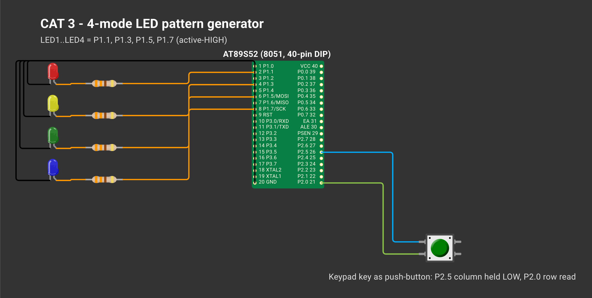

# EXPERIMENT DETAILS

**EXP:** CONTINUOUS ASSESSMENT 3

**DATE:** 27/09/2025

**NAME OF EXP:** Timer-Based LED Pattern Generator and Button Controller

**HARDWARE SETUP / PLATFORM:** AT89S52 development board (8051 architecture, 11.0592 MHz crystal) + 4 LEDs + push-button — Keil µVision 5 (C51), progisp + USBasp ISP programmer

---

## ACTIVITY : Four-State LED Control System

### 1. Circuit Diagram

| Signal | Pin Mapping |
|---|---|
| LED1 / LED2 / LED3 / LED4 | P1.1 / P1.3 / P1.5 / P1.7 (active-HIGH via 330 Ω resistors) |
| Push-button input | Matrix keypad switch: column P2.5 driven LOW, row P2.0 sampled |

*Created in [Wokwi](https://wokwi.com). To view or modify the schematic: open a new project on wokwi.com, copy [`wokwi/diagram.json`](wokwi/diagram.json) into the `diagram.json` editor, and upload any accompanying `wokwi/*.chip.json` custom definitions via **New file**. Custom chip definitions represent the AT89S52, USB-TTL adapter, ULN2003 driver, USBasp programmer, and ST-LINK dongle. In later diagrams, the ESP-01 and BMP180 symbols represent the Wemos D1 mini and BME280 respectively (sharing identical pinouts and protocols), while the Nucleo-64 board represents the F401RE.*

### 2. Core Logic / Pseudocode / Code Base

**Working Principle:**

The controller is structured around a finite state machine tracked by `mode`. A helper function `leds_write(pattern)` maps a 4-bit value (bit 3 → LED1 down to bit 0 → LED4) onto the Port 1 pins, decoupling pattern calculation from pin wiring. The main loop executes on a 10 ms tick and calls `button_pressed_event()`, which validates a state change only after two consecutive identical readings (20 ms total debounce window) without blocking the loop. Because it triggers exclusively on the released-to-pressed transition, holding the button never causes multiple mode jumps. Meanwhile, the LED animation advances once every 30 ticks (300 ms), keeping button polling responsive at all times.

| State (`mode`) | LED1 LED2 LED3 LED4 Sequence |
|---|---|
| 0 (Idle) | `0000` (all LEDs off at reset) |
| 1 (Running) | `1000` → `0100` → `0010` → `0001` |
| 2 (Binary count) | `0000` → … → `1111` |
| 3 (Alternating) | `1010` ↔ `0101` |
| 4 (Flash all) | `1111` ↔ `0000` |

**Pseudocode:**

1. Drive the keypad column line LOW, turn all four LEDs OFF, and initialise `mode = 0`.
2. On every 10 ms tick, poll `button_pressed_event()`; when a new press edge is detected, advance `mode` (wrapping from 4 back to 1) and reset `step = 0`.
3. Every 30 ticks (300 ms), evaluate `pattern_for(mode, step)` and output the 4-bit pattern to Port 1.
4. Increment `step` (wrapping modulo 4 in Running mode and modulo 16 in Binary mode).

**Code Base:**

- Project files: `TASK3A.uvproj` (Keil µVision project), `STARTUP.A51`, compiled binary `Objects/TASK3A.hex`.
- `main.c` — implements `leds_write()`, `button_pressed_event()`, and `pattern_for()`
- `delay.c/.h` — reusable `delay_ms()` timing library from CAT 2
- `TASK3A.uvproj`

### 3. Inference

Combining a non-blocking 20 ms edge-detecting debounce filter with a state-driven pattern generator ensures that each button press cleanly advances the LED sequence by exactly one mode.
