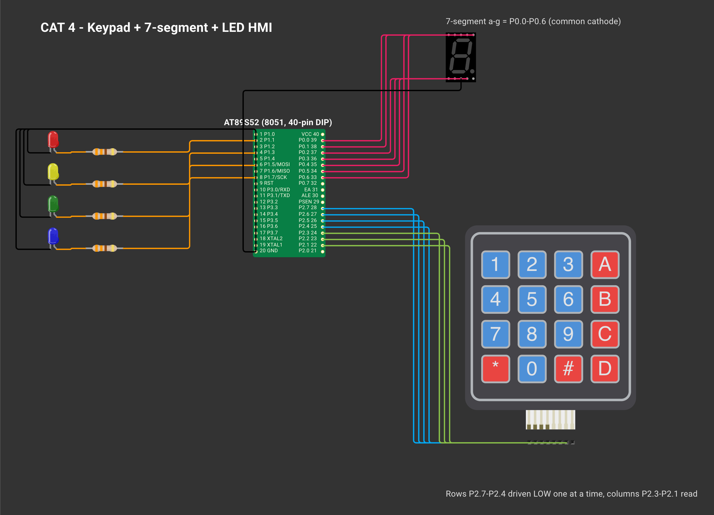

# EXPERIMENT DETAILS

**EXP:** CONTINUOUS ASSESSMENT 4

**DATE:** 03/08/2026

**NAME OF EXP:** Human-Machine Interface using Matrix Keypad, LEDs and Seven-Segment Display

**HARDWARE SETUP / PLATFORM:** AT89S52 development board (8051 architecture, 11.0592 MHz crystal) + 4×3 matrix keypad + 7-segment display + 4 LEDs — Keil µVision 5 (C51), progisp + USBasp ISP programmer

---

## TASK : Keypad-Controlled Display and LED Operations

### 1. Circuit Diagram

| Interface | Port Pins |
|---|---|
| Keypad rows R1–R4 | P2.7–P2.4 (scanned outputs) |
| Keypad columns C1–C3 | P2.3–P2.1 (sampled inputs) |
| 7-segment segments a–g | P0.0–P0.6 (common-cathode display) |
| Discrete LEDs LED1–LED4 | P1.1, P1.3, P1.5, P1.7 |

*Created in [Wokwi](https://wokwi.com). To view or modify the schematic: open a new project on wokwi.com, copy [`wokwi/diagram.json`](wokwi/diagram.json) into the `diagram.json` editor, and upload any accompanying `wokwi/*.chip.json` custom definitions via **New file**. Custom chip definitions represent the AT89S52, USB-TTL adapter, ULN2003 driver, USBasp programmer, and ST-LINK dongle. In later diagrams, the ESP-01 and BMP180 symbols represent the Wemos D1 mini and BME280 respectively (sharing identical pinouts and protocols), while the Nucleo-64 board represents the F401RE.*

### 2. Core Logic / Pseudocode / Code Base

**Working Principle:**

The matrix keypad is scanned by pulling one row LOW at a time (`P2 = ~(0x80 >> row)`) and inspecting the three column inputs. When a low column is detected, the routine waits 15 ms to confirm the contact and reports the key once per press cycle. Key characters and 7-segment font patterns are stored in ROM look-up tables (`KEYMAP[4][3]` and `SEG_CODE[10]`).

| Key Pressed | 7-Segment Output | Triggered LED Operation |
|---|---|---|
| `1`–`4` | `1`–`4` | Turn corresponding individual LEDn ON |
| `5` | `5` | Running LED chaser |
| `6` | `6` | Alternating pattern (`1010` ↔ `0101`) |
| `7` | `7` | 4-bit binary counter (`0`–`15`) |
| `8` | `8` | Blink all LEDs simultaneously |
| `9` | `9` | Turn all LEDs OFF |
| `0` | `0` | System reset (clear LEDs and display) |

**Pseudocode:**

1. Initialise all LEDs to OFF and blank the 7-segment display.
2. Poll `keypad_scan()` every 10 ms.
3. Whenever a new key press is registered, invoke `display_digit(key)` and `led_control(key)`.
4. Every 250 ms, advance whichever continuous animation is active (`running_led()`, `alternate_led()`, `binary_counter()`, or `blink_all()`).

**Code Base:**

- Project files: `TASK4A.uvproj` (Keil µVision project), `STARTUP.A51`, compiled binary `Objects/TASK4A.hex`.
- `keypad_scan()`, `display_digit()`, `led_control()`, `running_led()`, `binary_counter()`, `alternate_led()`, `blink_all()` — modular functions matching the lab specification
- `delay.c/.h`

### 3. Inference

Row-column multiplexing reads 12 switches using only 7 GPIO pins, while showing the active key on the 7-segment display and dispatching LED patterns through modular handler functions.
