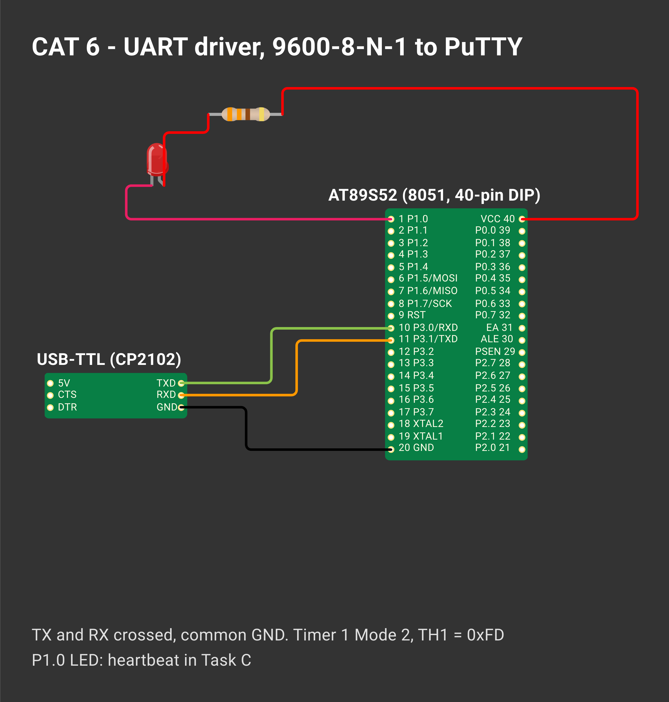

# EXPERIMENT DETAILS

**EXP:** CONTINUOUS ASSESSMENT 6

**DATE:** 17/08/2026

**NAME OF EXP:** UART Driver and Serial Debugging

**HARDWARE SETUP / PLATFORM:** AT89S52 development board (8051 architecture, 11.0592 MHz crystal) + USB-to-TTL serial adapter + PuTTY — Keil µVision 5 (C51), progisp + USBasp ISP programmer, PuTTY

---

## TASK B : UART Echo

### 1. Circuit Diagram

| 8051 Pin | USB-to-TTL Pin |
|---|---|
| P3.1 (`TXD`) | `RX` |
| P3.0 (`RXD`) | `TX` |
| `GND` | `GND` |

PuTTY terminal configuration: **9600 baud, 8 data bits, no parity, 1 stop bit (9600-8-N-1)**.



*Created in [Wokwi](https://wokwi.com). To view or modify the schematic: open a new project on wokwi.com, copy [`wokwi/diagram.json`](wokwi/diagram.json) into the `diagram.json` editor, and upload any accompanying `wokwi/*.chip.json` custom definitions via **New file**. Custom chip definitions represent the AT89S52, USB-TTL adapter, ULN2003 driver, USBasp programmer, and ST-LINK dongle. In later diagrams, the ESP-01 and BMP180 symbols represent the Wemos D1 mini and BME280 respectively (sharing identical pinouts and protocols), while the Nucleo-64 board represents the F401RE.*

### 2. Core Logic / Pseudocode / Code Base

**Working Principle:**

`uart_getc()` blocks until the receive interrupt flag `RI` goes high, reads the incoming byte from `SBUF`, and clears `RI`. Each received byte is immediately echoed back to the terminal via `uart_putc()`, appending a line feed (`\n`) whenever a carriage return (`\r`) is encountered.

**Pseudocode:**

1. Initialise the UART at 9600 baud and transmit a startup banner.
2. Poll `RI` via `uart_getc()` until a character arrives from the PC.
3. Transmit the character back via `uart_putc()`, emitting `\n` after `\r`.
4. Repeat continuously.

**Code Base:**

- Project files: `TASK6B.uvproj` (Keil µVision project), `STARTUP.A51`, compiled binary `Objects/TASK6B.hex`.
- `main.c` — combines `uart_getc()` and `uart_putc()` for full-duplex character loopback

**Expected Output:**

```
typed: ABC123      → shown: ABC123
typed: Hello 8051  → shown: Hello 8051
```

**Hardware Register Summary:**

| Aspect | Register / Formula |
|---|---|
| UART I/O pins | `TXD` on P3.1, `RXD` on P3.0 (Port 3 alternate functions) |
| Serial control | `SCON`: Mode 1 (8-bit UART, variable baud) + `REN = 1` → `SCON = 0x50` |
| Data buffer | `SBUF` (physically separate transmit and receive registers sharing one SFR address) |
| Transmit flag | `TI` is asserted by hardware at the stop bit and must be cleared in software |
| Baud clock source | Timer 1 operating in Mode 2 (8-bit auto-reload) |
| 9600 baud reload | `11059200 / (384 × (256 − TH1))` → `TH1 = 0xFD` |
| Receive flag | `RI` is asserted when a complete frame arrives in `SBUF` |

### 3. Inference

Successful character loopback from PuTTY to the AT89S52 and back confirms bidirectional serial communication across both the `RXD` and `TXD` paths.
