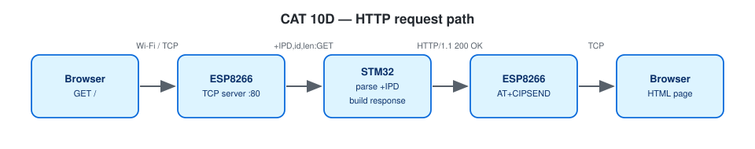

# EXPERIMENT DETAILS

**EXP:** CONTINUOUS ASSESSMENT 10

**DATE:** 05/10/2026 (Tasks 10C/10d: 12/10/2026)

**NAME OF EXP:** STM32–Wemos Wi-Fi Modem Interface Using AT Commands + HTTP Server

**HARDWARE SETUP / PLATFORM:** Blue Pill STM32F103C8T6 (ARM Cortex-M3, 72 MHz) + Wemos D1 mini (ESP8266 AT firmware) + USB-to-TTL serial adapter — STM32CubeMX + Keil MDK-ARM (STM32CubeIDE project included), STM32 HAL, PuTTY

---

## TASK 9A : Establish STM32 ↔ Wemos UART Communication

> Note: The CAT 10 lab handout labels this exercise **Task 9A**; in this repository it is located in `TASK10A`.

### 1. Circuit Diagram

| STM32 Pin | Target Connection | Role |
|---|---|---|
| `PA9` (`USART1_TX`) | Wemos `RX` | Transmit AT commands to ESP8266 |
| `PA10` (`USART1_RX`) | Wemos `TX` | Receive AT responses from ESP8266 |
| `PA2` (`USART2_TX`) / `PA3` (`USART2_RX`) | USB-to-TTL `RX` / `TX` | Debug console to PC (PuTTY) |
| `GND` | Shared ground rail | Common reference |

Both `USART1` and `USART2` operate at **115200-8-N-1**. Wi-Fi network credentials are read from `Core/Inc/wifi_secrets.h` (git-ignored; see `wifi_config.h` for template macros).


*Created in [Wokwi](https://wokwi.com). To view or modify the schematic: open a new project on wokwi.com, copy [`wokwi/diagram.json`](wokwi/diagram.json) into the `diagram.json` editor, and upload any accompanying `wokwi/*.chip.json` custom definitions via **New file**. Custom chip definitions represent the AT89S52, USB-TTL adapter, ULN2003 driver, USBasp programmer, and ST-LINK dongle. In later diagrams, the ESP-01 and BMP180 symbols represent the Wemos D1 mini and BME280 respectively (sharing identical pinouts and protocols), while the Nucleo-64 board represents the F401RE.*



### 2. Core Logic / Pseudocode / Code Base

**Working Principle:**

After waiting 2 s for the ESP8266 module to finish booting, the STM32 issues `AT` over `USART1`, gathers response lines until a terminal status (`OK`, `ERROR`, or `FAIL`) or timeout occurs, and forwards the transcript to `USART2`. Once verified, the firmware switches into a transparent dual-UART bridge so the user can type arbitrary AT commands interactively from PuTTY.

**Pseudocode:**

1. Print the startup banner on `USART2`.
2. Call `esp_startup()`: wait for modem boot, retry `AT` up to 3 times, and disable echo (`ATE0`).
3. Run `at_show("AT")` to log `>> AT` and `<< OK` on the PC console.
4. Call `at_bridge_start()`: arm interrupt-driven reception on both UARTs into dedicated 256-byte ring buffers (255 usable bytes), automatically retrying in the main loop if `HAL_UART_Receive_IT` ever reports busy.
5. Use interrupt-driven transmission (`HAL_UART_Transmit_IT`) backed by 512-byte TX ring buffers (511 usable bytes) in both directions so forwarding never blocks; track TX ring saturation separately from RX overflows.
6. In the main loop, call `at_bridge_poll()` to batch-forward buffered bytes (converting PuTTY `\r` into `\r\n` for the modem) and report any dropped bytes or TX errors.

**Code Base:**

- Project files: `CAT10A_STM32_Wemos_UART_Link.ioc` (STM32CubeMX configuration), `MDK-ARM/CAT10A_STM32_Wemos_UART_Link.uvprojx` (Keil MDK), `.project` / `.cproject` (STM32CubeIDE); firmware entry point in `Core/Src/main.c`.
- `esp_read_line()` — timeout-protected line reader
- `at_command()` — collects response lines until a terminal status token
- `at_show()` — formats and logs sent commands and received responses

**Expected Output:**

```
STM32-WiFi MODEM TEST  (CAT10A)
ESP8266 answered, echo off
>> AT
<< OK
```

### 3. Inference

Receiving `OK` from the Wemos D1 mini confirms the `USART1` physical link and baud rate, while dedicating `USART2` to the PC terminal keeps debug logs cleanly separated from modem traffic.
