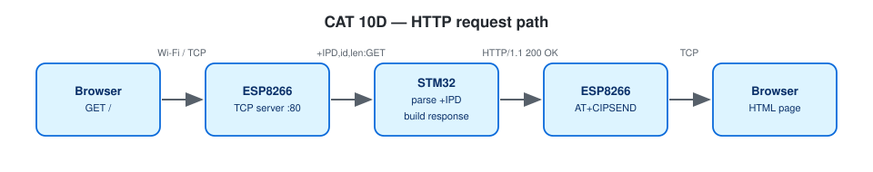

# EXPERIMENT DETAILS

**EXP:** CONTINUOUS ASSESSMENT 10

**DATE:** 05/10/2026 (Tasks 10C/10d: 12/10/2026)

**NAME OF EXP:** STM32–Wemos Wi-Fi Modem Interface Using AT Commands + HTTP Server

**HARDWARE SETUP / PLATFORM:** Blue Pill STM32F103C8T6 (ARM Cortex-M3, 72 MHz) + Wemos D1 mini (ESP8266 AT firmware) + USB-to-TTL serial adapter — STM32CubeMX + Keil MDK-ARM (STM32CubeIDE project included), STM32 HAL, PuTTY

---

## TASK 9B : Explore the ESP8266 AT Command Interface

> Note: The CAT 10 lab handout labels this exercise **Task 9B**; in this repository it is located in `TASK10B`.

### 1. Circuit Diagram

| STM32 Pin | Target Connection | Role |
|---|---|---|
| `PA9` (`USART1_TX`) | Wemos `RX` | Transmit AT commands to ESP8266 |
| `PA10` (`USART1_RX`) | Wemos `TX` | Receive AT responses from ESP8266 |
| `PA2` (`USART2_TX`) / `PA3` (`USART2_RX`) | USB-to-TTL `RX` / `TX` | Debug console to PC (PuTTY) |
| `GND` | Shared ground rail | Common reference |

Both `USART1` and `USART2` operate at **115200-8-N-1**. Wi-Fi network credentials are read from `Core/Inc/wifi_secrets.h` (git-ignored; see `wifi_config.h` for template macros).


*Created in [Wokwi](https://wokwi.com). To view or modify the schematic: open a new project on wokwi.com, copy [`wokwi/diagram.json`](wokwi/diagram.json) into the `diagram.json` editor, and upload any accompanying `wokwi/*.chip.json` custom definitions via **New file**. Custom chip definitions represent the AT89S52, USB-TTL adapter, ULN2003 driver, USBasp programmer, and ST-LINK dongle. In later diagrams, the ESP-01 and BMP180 symbols represent the Wemos D1 mini and BME280 respectively (sharing identical pinouts and protocols), while the Nucleo-64 board represents the F401RE.*



### 2. Core Logic / Pseudocode / Code Base

**Working Principle:**

Every AT command sent to the ESP8266 is terminated with `\r\n`, and the modem concludes every response with a final status line (`OK`, `ERROR`, or `FAIL`).

| Operation | AT Command Syntax |
|---|---|
| Verify modem presence | `AT` |
| Query firmware version | `AT+GMR` |
| Select Wi-Fi Station mode | `AT+CWMODE=1` |
| Scan nearby access points | `AT+CWLAP` |
| Associate with an AP | `AT+CWJAP="ssid","pwd"` |
| Query IP and MAC addresses | `AT+CIFSR` |
| Open a TCP client socket | `AT+CIPSTART="TCP","host",port` |
| Transmit payload bytes | `AT+CIPSEND=<len>` |

**Pseudocode:**

1. Perform the initial modem handshake as in Task 10A.
2. Sequentially issue `AT`, `AT+GMR`, `AT+CWMODE=1`, and `AT+CWLAP`, buffering each multi-line response before printing it to `USART2`.
3. Display the summary reference table of AT commands on the terminal.
4. Enter interactive UART bridge mode.

**Code Base:**

- Project files: `CAT10B_ESP8266_AT_Command_Explorer.ioc` (STM32CubeMX configuration), `MDK-ARM/CAT10B_ESP8266_AT_Command_Explorer.uvprojx` (Keil MDK), `.project` / `.cproject` (STM32CubeIDE); firmware entry point in `Core/Src/main.c`.
- Buffers full modem replies in a 1 KB RAM buffer prior to printing on `USART2` so incoming `USART1` bytes are never missed during console output

**Expected Output:**

```
>> AT+GMR
<< AT version:...
<< SDK version:...
<< OK
>> AT+CWLAP
<< +CWLAP:(3,"SNUC",-58,...)
<< OK
```

### 3. Inference

A unified command-and-response helper can query firmware metadata, configure Wi-Fi station mode, and enumerate nearby wireless networks over the AT interface.
