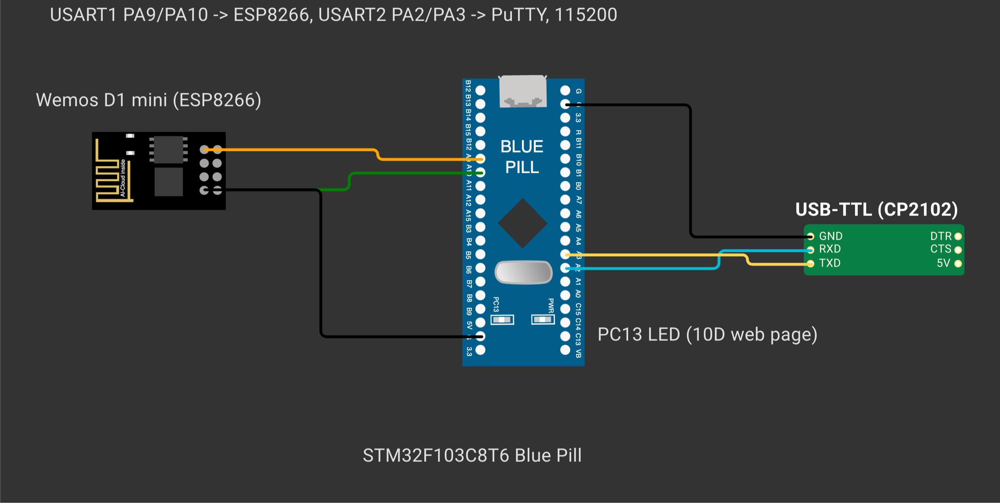
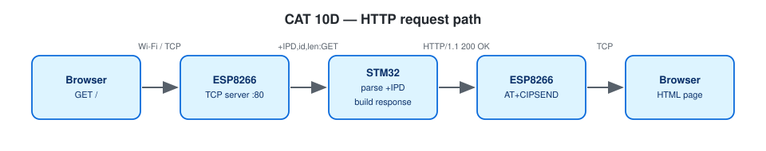

# EXPERIMENT DETAILS

**EXP:** CONTINUOUS ASSESSMENT 10

**DATE:** 05/10/2026 (Tasks 10C/10d: 12/10/2026)

**NAME OF EXP:** STM32–Wemos Wi-Fi Modem Interface Using AT Commands + HTTP Server

**HARDWARE SETUP / PLATFORM:** Blue Pill STM32F103C8T6 (ARM Cortex-M3, 72 MHz) + Wemos D1 mini (ESP8266 AT firmware) + USB-to-TTL serial adapter — STM32CubeMX + Keil MDK-ARM (STM32CubeIDE project included), STM32 HAL, PuTTY

---

## TASK 10C / 10D : Configure ESP8266 as a TCP Server, HTTP Response

### 1. Circuit Diagram

| STM32 Pin | Target Connection | Role |
|---|---|---|
| `PA9` (`USART1_TX`) | Wemos `RX` | Transmit AT commands to ESP8266 |
| `PA10` (`USART1_RX`) | Wemos `TX` | Receive AT responses from ESP8266 |
| `PA2` (`USART2_TX`) / `PA3` (`USART2_RX`) | USB-to-TTL `RX` / `TX` | Debug console to PC (PuTTY) |
| `GND` | Shared ground rail | Common reference |

Both `USART1` and `USART2` operate at **115200-8-N-1**. Wi-Fi network credentials are read from `Core/Inc/wifi_secrets.h` (git-ignored; see `wifi_config.h` for template macros).



*Created in [Wokwi](https://wokwi.com). To view or modify the schematic: open a new project on wokwi.com, copy [`wokwi/diagram.json`](wokwi/diagram.json) into the `diagram.json` editor, and upload any accompanying `wokwi/*.chip.json` custom definitions via **New file**. Custom chip definitions represent the AT89S52, USB-TTL adapter, ULN2003 driver, USBasp programmer, and ST-LINK dongle. In later diagrams, the ESP-01 and BMP180 symbols represent the Wemos D1 mini and BME280 respectively (sharing identical pinouts and protocols), while the Nucleo-64 board represents the F401RE.*



### 2. Core Logic / Pseudocode / Code Base

**Working Principle:**

Issuing `AT+CIPMUX=1` followed by `AT+CIPSERVER=1,80` configures the ESP8266 as a multi-connection TCP server listening on port 80. When a web browser connects, the modem forwards the request header as `+IPD,<id>,<len>:GET /path HTTP/1.1`. Incoming `USART1` bytes are captured by an interrupt-driven ring buffer (`esp_at.c`), and unsolicited `+IPD` notifications are dispatched to `on_esp_event()`, which records the requested URI path for connection `<id>`. The foreground loop then formats a complete HTTP/1.1 message:

```
HTTP/1.1 200 OK
Content-Type: text/html
Content-Length: <strlen(body)>
Connection: close

<html><body><h1>STM32 IoT Node</h1>...</body></html>
```
and transmits it via the two-stage sequence `AT+CIPSEND=<id>,<len>` → wait for `>` → send raw HTTP bytes → wait for `SEND OK` → `AT+CIPCLOSE=<id>`. Visiting `/led/on` or `/led/off` also switches the `PC13` LED.

**Pseudocode:**

1. Initialise the modem, connect to Wi-Fi, enable multi-link server mode on port 80, and print the server URL.
2. In the main loop, pump incoming ESP lines and route unsolicited events to `on_esp_event()`.
3. For each connection link with a pending request, construct the HTML page (or `404 Not Found`) and send it over `CIPSEND`.
4. If a `WIFI DISCONNECT` event occurs, wait for the link to re-associate and re-enable the TCP server.

**Code Base:**

- Project files: `CAT10D_HTTP_Server_Static_Page.ioc` (STM32CubeMX configuration), `MDK-ARM/CAT10D_HTTP_Server_Static_Page.uvprojx` (Keil MDK), `.project` / `.cproject` (STM32CubeIDE); firmware entry point in `Core/Src/main.c`.
- `esp_at.c/.h` — interrupt-driven RX ring buffer, timeout management, and `esp_at_send()`
- `USART1` NVIC interrupt enabled in `stm32f1xx_it.c`, `stm32f1xx_hal_msp.c`, and `.ioc`
- `handle_request()` and `http_send()`

**Expected Output:**

```
Server running: http://192.168.x.x/
[HTTP] link 0  GET /
[HTTP] link 1  GET /favicon.ico
```

### 3. Inference

By parsing `+IPD` frames and formatting HTTP headers with an exact `Content-Length`, the STM32 serves live HTML pages and handles browser routes directly through the ESP8266 TCP server.
