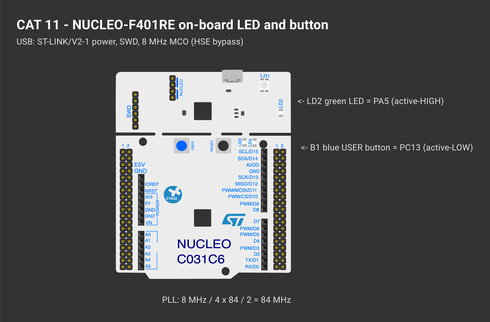

# EXPERIMENT DETAILS

**EXP:** CONTINUOUS ASSESSMENT 11

**DATE:** 14/10/2026

**NAME OF EXP:** STM32F401RE Cortex-M4: GPIO and User Input Programming

**HARDWARE SETUP / PLATFORM:** NUCLEO-F401RE (STM32F401RET6, ARM Cortex-M4F, 84 MHz) — STM32CubeMX + Keil MDK-ARM (STM32CubeIDE project included), STM32 HAL

---

## TASK 1 : On-board LED Bring-Up

### 1. Circuit Diagram

| Parameter | Hardware Details |
|---|---|
| Clock Source | No dedicated high-speed crystal on the target MCU; receives an 8 MHz clock from the on-board ST-LINK MCO (**HSE bypass** mode) |
| Microcontroller | STM32F401RET6, up to 84 MHz SYSCLK, 512 KB Flash, 96 KB SRAM |
| Available Peripherals | Ports GPIOA–GPIOD & GPIOH / 3× USART (1, 2, 6) / 3× I²C / 4× SPI |
| CubeMX PLL Tree | `8 MHz ÷ 4 × 84 ÷ 2 = 84 MHz` SYSCLK (`APB1 = 42 MHz`) |
| User LED (`LD2`) | `PA5`, **active-HIGH** |
| User Button (`B1`) | `PC13`, **active-LOW** |

*Created in [Wokwi](https://wokwi.com). To view or modify the schematic: open a new project on wokwi.com, copy [`wokwi/diagram.json`](wokwi/diagram.json) into the `diagram.json` editor, and upload any accompanying `wokwi/*.chip.json` custom definitions via **New file**. Custom chip definitions represent the AT89S52, USB-TTL adapter, ULN2003 driver, USBasp programmer, and ST-LINK dongle. In later diagrams, the ESP-01 and BMP180 symbols represent the Wemos D1 mini and BME280 respectively (sharing identical pinouts and protocols), while the Nucleo-64 board represents the F401RE.*

### 2. Core Logic / Pseudocode / Code Base

**Working Principle:**

At startup, `HAL_RCC_GetSysClockFreq()` queries the active system clock configured by CubeMX. If `SYSCLK` equals the expected 84 MHz, the user LED `LD2` (`PA5`) toggles every 500 ms (1 Hz); if the clock tree is misconfigured, it falls back to a rapid 100 ms warning flash. All timing is driven non-blockingly via `HAL_GetTick()`.

**Pseudocode:**

1. Query `HAL_RCC_GetSysClockFreq()` and select the half-period interval (500 ms for 84 MHz, else 100 ms).
2. Initialise `LD2` (`PA5`) to OFF.
3. In the main loop, once the target interval has elapsed on `HAL_GetTick()`, invert `PA5` and record the new timestamp.

**Code Base:**

- Project files: `CAT11_Task1_LED_BringUp.ioc` (STM32CubeMX configuration), `MDK-ARM/CAT11_Task1_LED_BringUp.uvprojx` (Keil MDK), `.project` / `.cproject` (STM32CubeIDE); firmware entry point in `Core/Src/main.c`.
- `sysclk_hz` (inspectable via debugger Live Expressions) and `blink_ms`

### 3. Inference

A steady 1 Hz blink on `LD2` confirms that the NUCLEO-F401RE board, HSE-bypass 84 MHz PLL tree, and `PA5` GPIO output are operating as configured.
