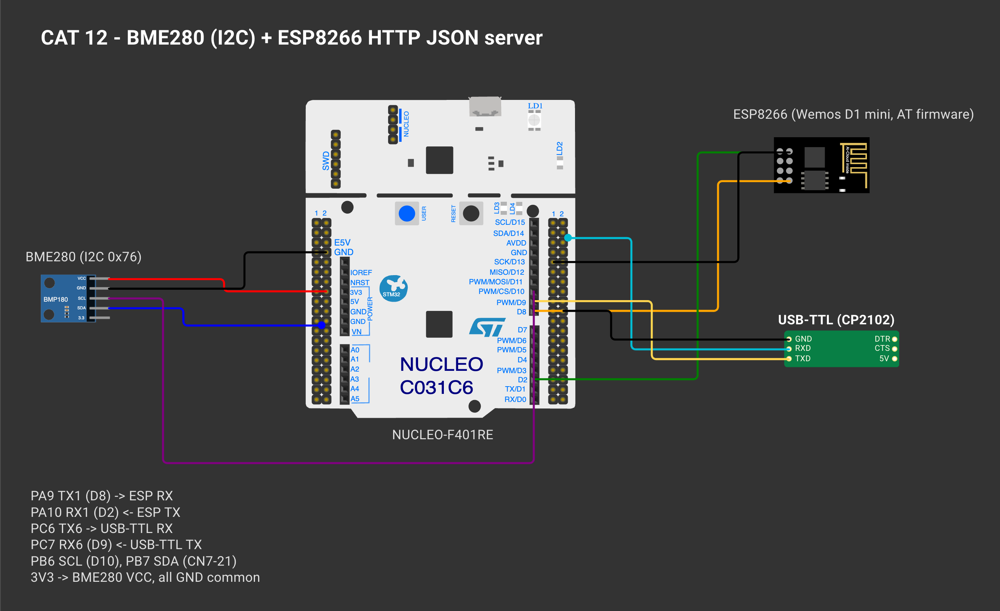
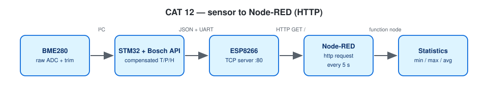

# EXPERIMENT DETAILS

**EXP:** CONTINUOUS ASSESSMENT 12

**DATE:** 23/10/2026

**NAME OF EXP:** BME280 Sensor Interfacing Using I²C and Bosch Sensor API, ESP8266 HTTP, Node Analytics

**HARDWARE SETUP / PLATFORM:** NUCLEO-F401RE (STM32F401RET6, ARM Cortex-M4F, 84 MHz) + Bosch BME280 + Wemos D1 mini + USB-to-TTL serial adapter — STM32CubeMX + Keil MDK-ARM (STM32CubeIDE project included), STM32 HAL, Bosch BME280 Sensor API v3.5.1, Node-RED

---

## Raw HTTP Response with BME280 Data

### 1. Circuit Diagram

| Nucleo-F401RE Pin | Connected Peripheral |
|---|---|
| `PB6` (`I2C1_SCL`) / `PB7` (`I2C1_SDA`) | BME280 `SCL` / `SDA` (100 kHz standard-mode I²C) |
| `3V3` / `GND` | BME280 `VCC` / `GND`, with `SDO` tied to `GND` (I²C address `0x76`) |
| `PA9` (`USART1_TX`) / `PA10` (`USART1_RX`) | Wemos `RX` / `TX` (115200 baud, interrupt-driven RX) |
| `PC6` (`USART6_TX`) / `PC7` (`USART6_RX`) | USB-to-TTL adapter for PC debug console (115200 baud) |



*Created in [Wokwi](https://wokwi.com). To view or modify the schematic: open a new project on wokwi.com, copy [`wokwi/diagram.json`](wokwi/diagram.json) into the `diagram.json` editor, and upload any accompanying `wokwi/*.chip.json` custom definitions via **New file**. Custom chip definitions represent the AT89S52, USB-TTL adapter, ULN2003 driver, USBasp programmer, and ST-LINK dongle. In later diagrams, the ESP-01 and BMP180 symbols represent the Wemos D1 mini and BME280 respectively (sharing identical pinouts and protocols), while the Nucleo-64 board represents the F401RE.*



### 2. Core Logic / Pseudocode / Code Base

**Working Principle:**

Using the shared `esp_at` driver, the ESP8266 associates with Wi-Fi and opens a TCP server on port 80. Whenever an HTTP client sends `GET /`, the STM32 serialises the latest compensated BME280 measurements into a JSON object and computes `Content-Length` dynamically via `strlen(json)`:

```
HTTP/1.1 200 OK
Content-Type: application/json
Content-Length: <calculated>
Access-Control-Allow-Origin: *
Connection: close

{"status":"success","temperature":28.45,"humidity":62.30,"pressure":1008.72}
```
Sensor polling is scheduled every 2 s using `HAL_GetTick()` timestamps rather than blocking delays. Each HTTP response is transmitted through a timeout-bounded `AT+CIPSEND` sequence (taking a few tens of milliseconds), serving incoming requests sequentially.

**Pseudocode:**

1. Initialise the BME280 sensor over I²C1.
2. Boot the ESP8266, connect to Wi-Fi, start the port-80 TCP server, and log the station URL.
3. In the main loop: process incoming modem URCs and reply to pending HTTP requests with the JSON payload (or `404`).
4. Every 2 s, sample fresh BME280 readings and print them on `USART6`.
5. Automatically re-establish the TCP server if a `WIFI DISCONNECT` occurs.

**Code Base:**

- Project files: `CAT12B_BME280_HTTP_JSON_Server.ioc` (STM32CubeMX configuration), `MDK-ARM/CAT12B_BME280_HTTP_JSON_Server.uvprojx` (Keil MDK), `.project` / `.cproject` (STM32CubeIDE); firmware entry point in `Core/Src/main.c`.
- `build_json()`, `http_reply()`, `handle_request()`, and `server_start()`

**Expected Output:**

```
{"status":"success","temperature":28.45,"humidity":62.30,"pressure":1008.72}
```

### 3. Inference

The STM32 formats standards-compliant HTTP/1.1 headers with an exact `Content-Length` and serves live BME280 JSON telemetry over Wi-Fi.

---

## NEXT STEP : Node-RED Statistics

### 1. Circuit Diagram

| Nucleo-F401RE Pin | Connected Peripheral |
|---|---|
| `PB6` (`I2C1_SCL`) / `PB7` (`I2C1_SDA`) | BME280 `SCL` / `SDA` (100 kHz standard-mode I²C) |
| `3V3` / `GND` | BME280 `VCC` / `GND`, with `SDO` tied to `GND` (I²C address `0x76`) |
| `PA9` (`USART1_TX`) / `PA10` (`USART1_RX`) | Wemos `RX` / `TX` (115200 baud, interrupt-driven RX) |
| `PC6` (`USART6_TX`) / `PC7` (`USART6_RX`) | USB-to-TTL adapter for PC debug console (115200 baud) |


*Created in [Wokwi](https://wokwi.com). To view or modify the schematic: open a new project on wokwi.com, copy [`wokwi/diagram.json`](wokwi/diagram.json) into the `diagram.json` editor, and upload any accompanying `wokwi/*.chip.json` custom definitions via **New file**. Custom chip definitions represent the AT89S52, USB-TTL adapter, ULN2003 driver, USBasp programmer, and ST-LINK dongle. In later diagrams, the ESP-01 and BMP180 symbols represent the Wemos D1 mini and BME280 respectively (sharing identical pinouts and protocols), while the Nucleo-64 board represents the F401RE.*


### 2. Core Logic / Pseudocode / Code Base

**Working Principle:**

The Node-RED flow (`NodeRED_CAT12_HTTP_Statistics_flow.json`) uses a 5 s `inject` node to trigger an `http request` node (`GET http://<STM32-IP>/`, returning a parsed JSON object). A downstream `function` node maintains running minimum, maximum, sum, and sample count values in flow context and outputs a formatted summary table to the `debug` sidebar. A second `inject` node resets the accumulated statistics on demand.

**Pseudocode:**

1. Import `NodeRED_CAT12_HTTP_Statistics_flow.json` into Node-RED, enter the STM32's IP address in the `http request` node, and click **Deploy**.
2. Allow the flow to poll several samples and inspect the formatted min/max/average table in the Debug pane.

**Code Base:**

- `NodeRED_CAT12_HTTP_Statistics_flow.json`

**Expected Output:**

```
Parameter            Minimum  Maximum  Average
Temperature (°C)       27.91    29.02    28.46
Humidity (%RH)          59.8     64.2    62.15
Pressure (hPa)       1007.84  1009.31  1008.56
```

### 3. Inference

Node-RED periodically polls the STM32 HTTP JSON endpoint and computes rolling min, max, and average statistics without requiring any firmware changes on the microcontroller.
