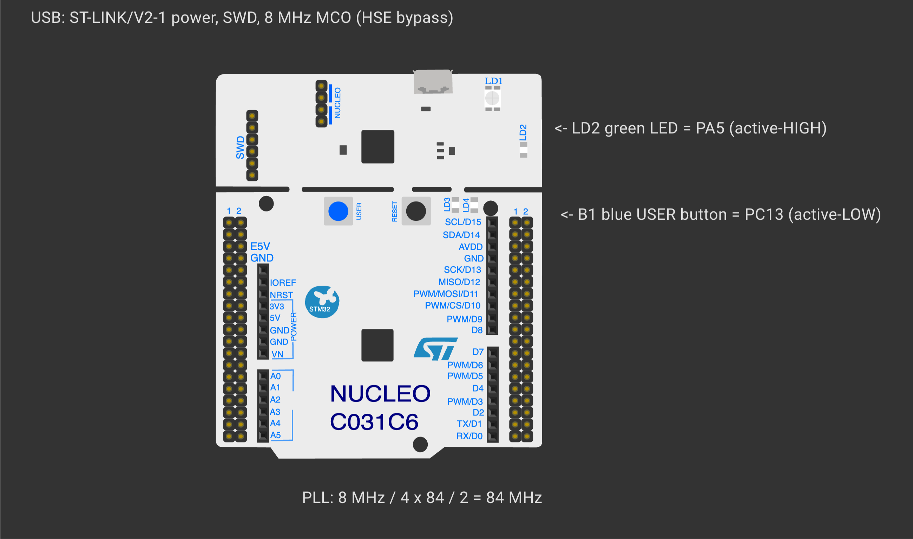

# EXPERIMENT DETAILS

**EXP:** CONTINUOUS ASSESSMENT 12

**DATE:** 14/10/2026

**NAME OF EXP:** STM32F401RE Cortex-M4: GPIO and User Input Programming

**HARDWARE SETUP / PLATFORM:** NUCLEO-F401RE (STM32F401RET6, ARM Cortex-M4F, 84 MHz) — STM32CubeMX + Keil MDK-ARM (STM32CubeIDE project included), STM32 HAL

---

## TASK 3 : Short-Press and Long-Press Detection

### 1. Circuit Diagram

| Parameter | Hardware Details |
|---|---|
| Clock Source | No dedicated high-speed crystal on the target MCU; receives an 8 MHz clock from the on-board ST-LINK MCO (**HSE bypass** mode) |
| Microcontroller | STM32F401RET6, up to 84 MHz SYSCLK, 512 KB Flash, 96 KB SRAM |
| Available Peripherals | Ports GPIOA–GPIOD & GPIOH / 3× USART (1, 2, 6) / 3× I²C / 4× SPI |
| CubeMX PLL Tree | `8 MHz ÷ 4 × 84 ÷ 2 = 84 MHz` SYSCLK (`APB1 = 42 MHz`) |
| User LED (`LD2`) | `PA5`, **active-HIGH** |
| User Button (`B1`) | `PC13`, **active-LOW** |

*Created in [Wokwi](https://wokwi.com). To view or modify the schematic: open a new project on wokwi.com, copy [`wokwi/diagram.json`](wokwi/diagram.json) into the `diagram.json` editor, and upload any accompanying `wokwi/*.chip.json` custom definitions via **New file**. Custom chip definitions represent the AT89S52, USB-TTL adapter, ULN2003 driver, USBasp programmer, and ST-LINK dongle. In later diagrams, the ESP-01 and BMP180 symbols represent the Wemos D1 mini and BME280 respectively (sharing identical pinouts and protocols), while the Nucleo-64 board represents the F401RE.*

### 2. Core Logic / Pseudocode / Code Base

**Working Principle:**

| Hold Duration | Classification | Resulting Action |
|---|---|---|
| `< 30 ms` | Contact bounce | Ignored by the debounce filter |
| `< 0.6 s` | Short press | Toggle static `LD2` state |
| `0.6 – 3 s` | Long press | Toggle 150 ms blinking mode ON / OFF |
| `≥ 3 s` | Very long press | Full reset (turn `LD2` OFF and disable blinking) |

Elapsed time is computed using unsigned 32-bit subtraction (`now - press_start`), which remains wrap-around safe across `HAL_GetTick()` rollovers. Because press duration is evaluated **upon release**, the selected action triggers as soon as the user lets go of `B1`.

**Pseudocode:**

1. On a debounced press edge, record `press_start = HAL_GetTick()`.
2. On the matching release edge, compute `duration = now - press_start` and pass it to `classify()`.
3. Execute the state transition corresponding to short, long, or very long press.
4. Whenever blink mode is active, toggle `LD2` every 150 ms.

**Code Base:**

- Project files: `CAT12_Task3_Short_Long_Press.ioc` (STM32CubeMX configuration), `MDK-ARM/CAT12_Task3_Short_Long_Press.uvprojx` (Keil MDK), `.project` / `.cproject` (STM32CubeIDE); firmware entry point in `Core/Src/main.c`.
- `classify()` and `last_duration` (observable in debugger Live Expressions)

### 3. Inference

Non-blocking tick arithmetic lets the Cortex-M4 distinguish short, long, and very-long button holds while simultaneously maintaining a 150 ms LED blink task.
