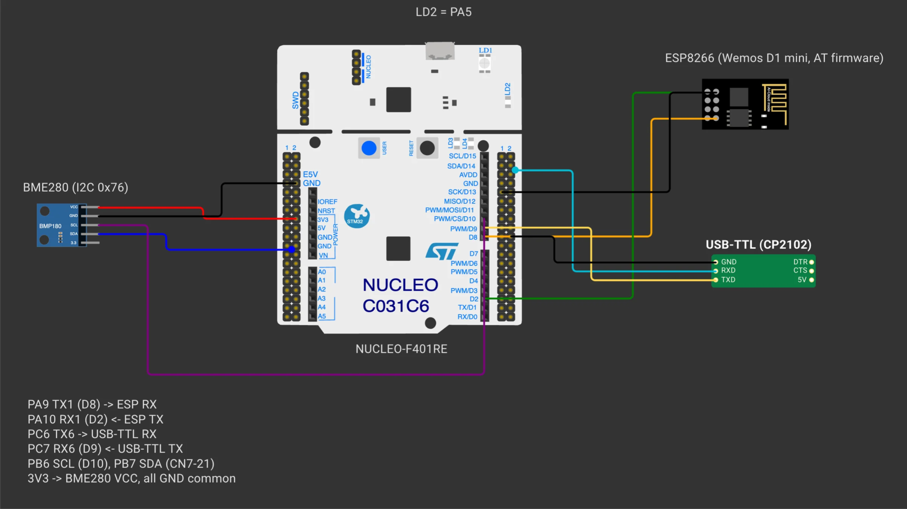
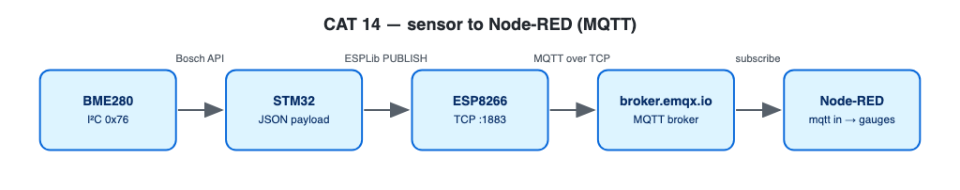

# EXPERIMENT DETAILS

**EXP:** CONTINUOUS ASSESSMENT 14

**DATE:** 27/10/2026

**NAME OF EXP:** BME280 Sensor Interfacing Using I²C and MQTT using Custom Built ESP8266 API

**HARDWARE SETUP / PLATFORM:** NUCLEO-F401RE (STM32F401RET6, ARM Cortex-M4F, 84 MHz) + Bosch BME280 + Wemos D1 mini — STM32CubeMX + Keil MDK-ARM (STM32CubeIDE project included), STM32 HAL, ESPLib API (clean-room implementation), Node-RED, `broker.emqx.io`

---

## DEVELOP THE APPLICATION : BME280 JSON over MQTT

### 1. Circuit Diagram

Uses the same hardware connections as CAT 13, with `LD2` (`PA5`) additionally used in CAT 14B. Connects to MQTT broker **`broker.emqx.io:1883`**.



*Created in [Wokwi](https://wokwi.com). To view or modify the schematic: open a new project on wokwi.com, copy [`wokwi/diagram.json`](wokwi/diagram.json) into the `diagram.json` editor, and upload any accompanying `wokwi/*.chip.json` custom definitions via **New file**. Custom chip definitions represent the AT89S52, USB-TTL adapter, ULN2003 driver, USBasp programmer, and ST-LINK dongle. In later diagrams, the ESP-01 and BMP180 symbols represent the Wemos D1 mini and BME280 respectively (sharing identical pinouts and protocols), while the Nucleo-64 board represents the F401RE.*



### 2. Core Logic / Pseudocode / Code Base

**Working Principle:**

The Bosch BME280 sensor is initialised over I²C1 as in CAT 13. Every 2 s, the compensated temperature, humidity, and pressure readings are formatted into the JSON payload
`{"status":"success","temperature":28.45,"humidity":62.30,"pressure":1008.72}` and published to topic `pranesh/stm32/bme280` at QoS 0.

**Pseudocode:**

1. Initialise the BME280 (`2×` oversampling, IIR filter off, Normal mode).
2. Connect to Wi-Fi and the MQTT broker via `mqtt_start()`.
3. In the main loop: read the sensor, format the payload with `build_json()`, publish to the broker, log to `USART6`, and wait 2 s.

**Code Base:**

- Project files: `CAT14C_BME280_MQTT_NodeRED.ioc` (STM32CubeMX configuration), `MDK-ARM/CAT14C_BME280_MQTT_NodeRED.uvprojx` (Keil MDK), `.project` / `.cproject` (STM32CubeIDE); firmware entry point in `Core/Src/main.c`.
- `build_json()`, `bme_setup()`, `bme_read()`, and `fmt_2dp()`

**Expected Output:**

```
PUB pranesh/stm32/bme280 {"status":"success","temperature":28.45,"humidity":62.30,"pressure":1008.72}
```

**ESPLib API Reference:**

| ESPLib Call | Underlying AT / MQTT Traffic |
|---|---|
| `ESP8266_Init(StationMode, huart1)` | Sends `AT` and `AT+CWMODE=1` |
| `ESP8266_wifiConnect()` | Sends `AT+CWQAP` and `AT+CWJAP` |
| `ESP8266_portConnect("TCP", broker, "1883")` | Opens TCP socket via `AT+CIPSTART` |
| `MQTT_connectBroker()` | Sends MQTT `CONNECT` (`0x10`, protocol `"MQTT"` level 4, clean session, keep-alive, client ID) |
| `MQTT_publishTopic()` | Sends MQTT `PUBLISH` (`0x30`, topic length + string, payload) |
| `MQTT_subscribeTopic()` | Sends MQTT `SUBSCRIBE` (`0x82`) |

**Clean-Room Library Improvements:** `ESPLib.h` preserves the exact function names from the lab handout so student application code compiles without changes, while `ESPLib.c` and `mqtt_packet.c` provide a new implementation that resolves the flaws of the original course driver:

| Limitation in Original Driver | Behaviour in Reworked Implementation |
|---|---|
| Aborted the UART RX interrupt on every transmit, dropping any broker packets that arrived mid-send | Arms the UART RX interrupt once at startup into a 1 KB ring buffer and never aborts it |
| Inferred packet boundaries from 100 ms of UART silence; left `colonIndex` uninitialised on `SUBACK` / `PINGRESP` frames | Strips `+IPD,<len>:` framing first and feeds payload bytes into a stateful MQTT parser driven by packet type and Remaining Length |
| Handled only 1-byte Remaining Length without bounds checks or guaranteed NUL termination | Decodes variable-length Remaining Length (up to 4 bytes), validates buffer capacities prior to copying, guarantees NUL-terminated strings, and skips oversized packets |
| Ignored `CONNACK` / `SUBACK` responses and used unbounded `do {} while` loops that could hang indefinitely | Verifies `CONNACK` acceptance and `SUBACK ≠ 0x80`; enforces timeouts on every wait and returns `funcOk` / `funcErr` |

Additional safeguards: `PINGREQ` verifies `PINGRESP` (reconnecting if the broker fails to respond), oversized topics are dropped and counted, and the firmware logs RX-overflow or dropped-packet counters whenever they increment.

The client operates strictly at **QoS 0**: publish or subscribe calls requesting QoS 1/2 return `funcErr`, `SUBACK` must grant QoS 0, and any incoming QoS 1/2 publish is discarded and counted. `UNSUBSCRIBE` verifies the matching `UNSUBACK`.

If a UART ring-buffer overflow or malformed `+IPD` header occurs, all buffered bytes are flushed, the parser resets, and both the TCP socket and MQTT session are marked disconnected to force a clean reconnect. If `HAL_UART_Receive_IT` ever fails to re-arm, the main loop retries automatically. `CONNACK` Session Present flags are validated and wildcard publish topics are rejected.

### 3. Inference

Publishing BME280 JSON payloads over MQTT decouples the sensor node from its consumers, allowing any number of subscribers to receive live telemetry simultaneously.

---

## NEXT STEP : Node-RED

### 1. Circuit Diagram

Uses the same hardware connections as CAT 13, with `LD2` (`PA5`) additionally used in CAT 14B. Connects to MQTT broker **`broker.emqx.io:1883`**.


*Created in [Wokwi](https://wokwi.com). To view or modify the schematic: open a new project on wokwi.com, copy [`wokwi/diagram.json`](wokwi/diagram.json) into the `diagram.json` editor, and upload any accompanying `wokwi/*.chip.json` custom definitions via **New file**. Custom chip definitions represent the AT89S52, USB-TTL adapter, ULN2003 driver, USBasp programmer, and ST-LINK dongle. In later diagrams, the ESP-01 and BMP180 symbols represent the Wemos D1 mini and BME280 respectively (sharing identical pinouts and protocols), while the Nucleo-64 board represents the F401RE.*


### 2. Core Logic / Pseudocode / Code Base

**Working Principle:**

- `NodeRED_CAT14_MQTT_flow.json`: subscribes via an **mqtt in** node (configured to output a parsed JSON object), routes the payload through a `function` node that splits temperature, humidity, and pressure onto separate debug outputs, computes rolling min/max/average statistics, and provides `ON` / `OFF` / `TOGGLE` inject buttons wired to an **mqtt out** node for controlling CAT 14B.
- `NodeRED_CAT14_Dashboard_flow.json`: feeds live temperature, humidity, and pressure streams into three dashboard gauges and a historical line chart (requires `node-red-dashboard`, accessible at `/ui`).

**Pseudocode:**

1. Import either flow JSON into Node-RED and click **Deploy**.
2. Observe the live sensor telemetry updating every 2 s in the Debug sidebar or `/ui` dashboard.

**Code Base:**

- `NodeRED_CAT14_MQTT_flow.json`
- `NodeRED_CAT14_Dashboard_flow.json`

**ESPLib API Reference:**

| ESPLib Call | Underlying AT / MQTT Traffic |
|---|---|
| `ESP8266_Init(StationMode, huart1)` | Sends `AT` and `AT+CWMODE=1` |
| `ESP8266_wifiConnect()` | Sends `AT+CWQAP` and `AT+CWJAP` |
| `ESP8266_portConnect("TCP", broker, "1883")` | Opens TCP socket via `AT+CIPSTART` |
| `MQTT_connectBroker()` | Sends MQTT `CONNECT` (`0x10`, protocol `"MQTT"` level 4, clean session, keep-alive, client ID) |
| `MQTT_publishTopic()` | Sends MQTT `PUBLISH` (`0x30`, topic length + string, payload) |
| `MQTT_subscribeTopic()` | Sends MQTT `SUBSCRIBE` (`0x82`) |

**Clean-Room Library Improvements:** `ESPLib.h` preserves the exact function names from the lab handout so student application code compiles without changes, while `ESPLib.c` and `mqtt_packet.c` provide a new implementation that resolves the flaws of the original course driver:

| Limitation in Original Driver | Behaviour in Reworked Implementation |
|---|---|
| Aborted the UART RX interrupt on every transmit, dropping any broker packets that arrived mid-send | Arms the UART RX interrupt once at startup into a 1 KB ring buffer and never aborts it |
| Inferred packet boundaries from 100 ms of UART silence; left `colonIndex` uninitialised on `SUBACK` / `PINGRESP` frames | Strips `+IPD,<len>:` framing first and feeds payload bytes into a stateful MQTT parser driven by packet type and Remaining Length |
| Handled only 1-byte Remaining Length without bounds checks or guaranteed NUL termination | Decodes variable-length Remaining Length (up to 4 bytes), validates buffer capacities prior to copying, guarantees NUL-terminated strings, and skips oversized packets |
| Ignored `CONNACK` / `SUBACK` responses and used unbounded `do {} while` loops that could hang indefinitely | Verifies `CONNACK` acceptance and `SUBACK ≠ 0x80`; enforces timeouts on every wait and returns `funcOk` / `funcErr` |

Additional safeguards: `PINGREQ` verifies `PINGRESP` (reconnecting if the broker fails to respond), oversized topics are dropped and counted, and the firmware logs RX-overflow or dropped-packet counters whenever they increment.

The client operates strictly at **QoS 0**: publish or subscribe calls requesting QoS 1/2 return `funcErr`, `SUBACK` must grant QoS 0, and any incoming QoS 1/2 publish is discarded and counted. `UNSUBSCRIBE` verifies the matching `UNSUBACK`.

If a UART ring-buffer overflow or malformed `+IPD` header occurs, all buffered bytes are flushed, the parser resets, and both the TCP socket and MQTT session are marked disconnected to force a clean reconnect. If `HAL_UART_Receive_IT` ever fails to re-arm, the main loop retries automatically. `CONNACK` Session Present flags are validated and wildcard publish topics are rejected.

### 3. Inference

Node-RED subscribes to the broker topic via `mqtt in` and visualises all three environmental readings on live gauges, trend charts, and statistical summaries.
