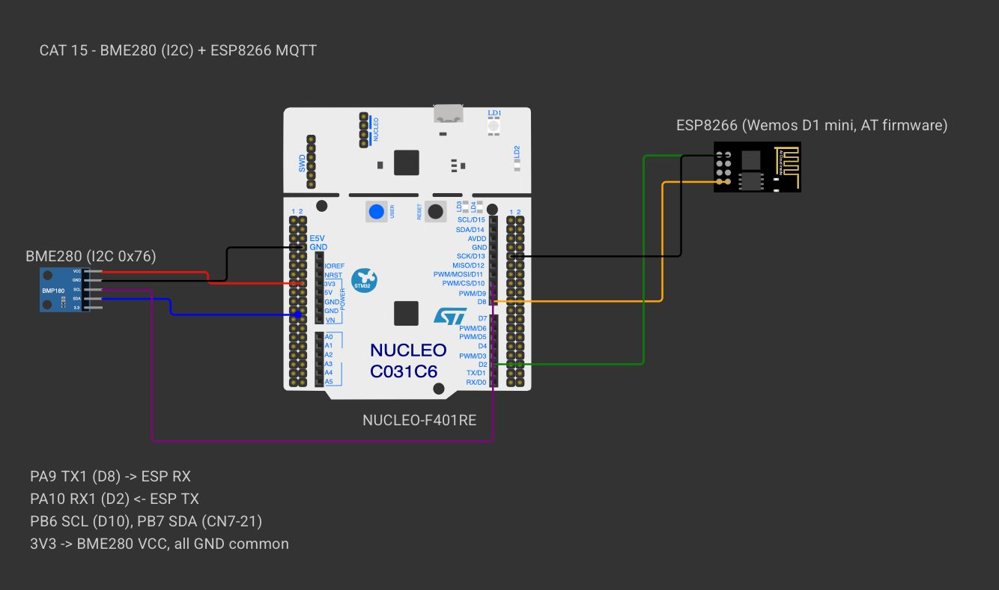
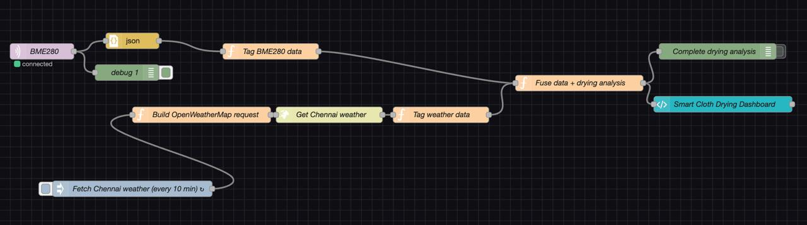
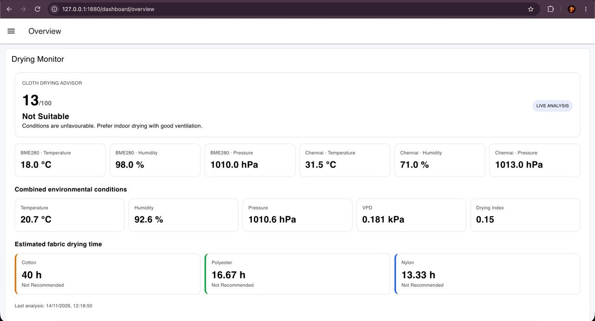
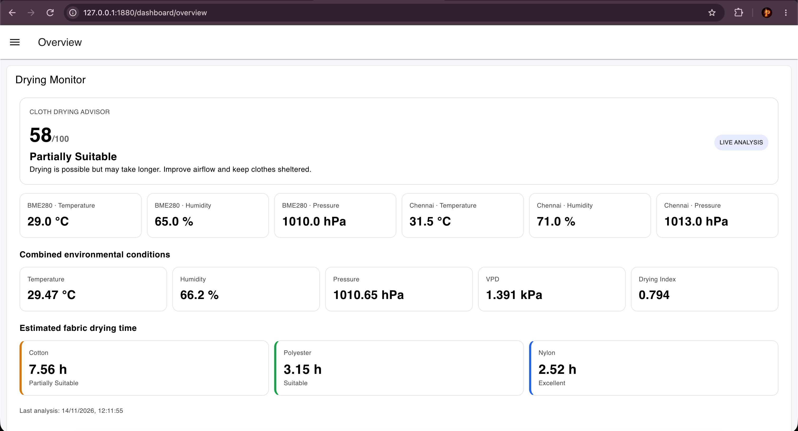
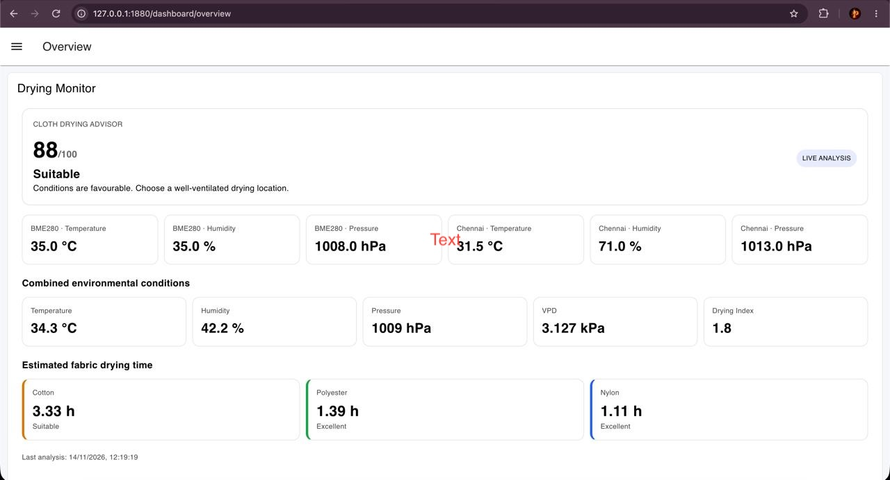

# EXPERIMENT DETAILS

**EXP:** CONTINUOUS ASSESSMENT 15

**DATE:** 19/11/2026

**NAME OF EXP:** PROJECT : Smart Cloth Drying System

**HARDWARE SETUP / PLATFORM:** NUCLEO-F401RE (STM32F401RET6, ARM Cortex-M4F, 84 MHz) + Bosch BME280 + Wemos D1 mini (ESP8266 AT firmware) — STM32CubeMX + Keil MDK-ARM, STM32 HAL, Bosch BME280 Sensor API, ESPLib MQTT API, Node-RED (`@flowfuse/node-red-dashboard`), OpenWeatherMap REST API, `broker.emqx.io`

---

## PROJECT : Smart Cloth Drying System

### 1. Circuit Diagram

| Nucleo-F401RE Pin | Connected Peripheral | Role |
|---|---|---|
| `PB6` (`I2C1_SCL`) / `PB7` (`I2C1_SDA`) | BME280 `SCL` / `SDA` | 100 kHz standard-mode I²C bus |
| `3V3` / `GND` | BME280 `VCC` / `GND` | Sensor power supply (`SDO` tied to `GND` for I²C address `0x76`) |
| `PA9` (`USART1_TX`) | Wemos D1 mini `RX` | Send AT commands and MQTT packets to ESP8266 (115200-8-N-1) |
| `PA10` (`USART1_RX`) | Wemos D1 mini `TX` | Receive AT responses from ESP8266 (115200-8-N-1) |
| `GND` | Common ground rail | Shared reference between Nucleo-F401RE, BME280, and Wemos D1 mini |

Connects over Wi-Fi to the public MQTT broker **`broker.emqx.io:1883`**.



*Created in [Wokwi](https://wokwi.com). To view or modify the schematic: open a new project on wokwi.com, copy [`wokwi/diagram.json`](wokwi/diagram.json) into the `diagram.json` editor, and upload any accompanying `wokwi/*.chip.json` custom definitions via **New file**. Custom chip definitions represent the AT89S52, USB-TTL adapter, ULN2003 driver, USBasp programmer, and ST-LINK dongle. In later diagrams, the ESP-01 and BMP180 symbols represent the Wemos D1 mini and BME280 respectively (sharing identical pinouts and protocols), while the Nucleo-64 board represents the F401RE.*

### 2. Core Logic / Pseudocode / Code Base

**Working Principle:**

The **Smart Cloth Drying System** combines real-time local micro-climate measurements from an STM32 + BME280 sensor node with regional meteorological forecasts from the OpenWeatherMap API to compute psychrometric drying metrics, overall outdoor/indoor drying suitability, and fabric-specific drying time estimates.

1. **Edge Sensing & MQTT Telemetry (STM32F401RE + BME280 + ESP8266):**
   - The STM32F401RE runs at 84 MHz (HSI + PLL) and initialises the Bosch BME280 sensor over `I2C1` at address `0x76` (`BME280_I2C_ADDR_PRIM`) with `1×` oversampling for temperature, pressure, and humidity (`BME280_OVERSAMPLING_1X`), IIR filter disabled (`BME280_FILTER_COEFF_OFF`), and normal continuous operating mode (`BME280_POWERMODE_NORMAL`).
   - Using `ESPLib`, the microcontroller configures the Wemos D1 mini (ESP8266) in station mode (`StationMode`) over `USART1` (115200 baud), associates with the Wi-Fi access point, opens a TCP socket to `broker.emqx.io:1883`, and establishes a clean-session MQTT connection (`clientID = "STM32_BME280_Publisher"`, `keepAlive = 500`).
   - Every 2 seconds, the firmware reads compensated temperature (°C), pressure (converted from Pa to hPa), and relative humidity (%RH), formats them into a JSON payload, and publishes to the MQTT broker at QoS 0.

2. **Cloud Weather Ingestion & Environmental Data Fusion (Node-RED):**
   - An `mqtt in` node subscribes to the STM32 sensor stream while an `inject` node triggers an OpenWeatherMap HTTP GET request (`lat=13.0827, lon=80.2707` — Chennai, metric units) every 10 minutes (`600 s`).
   - Once both sources are available in flow context (`dryingState`), the `Fuse data + drying analysis` node computes a weighted environmental fusion that prioritises local balcony/indoor conditions (**80% BME280**) while accounting for ambient outdoor trends (**20% Chennai Weather**):
     - $T_{\text{raw}} = 0.8 \cdot T_{\text{BME280}} + 0.2 \cdot T_{\text{Chennai}}$
     - $\text{RH}_{\text{raw}} = 0.8 \cdot \text{RH}_{\text{BME280}} + 0.2 \cdot \text{RH}_{\text{Chennai}}$
     - $P_{\text{raw}} = 0.8 \cdot P_{\text{BME280}} + 0.2 \cdot P_{\text{Chennai}}$
   - An Exponential Moving Average (EMA) filter ($\alpha = 1.0$ for independent test-case evaluation; configurable to $\alpha = 0.8$ for continuous live smoothing) produces the filtered state $(T, \text{RH}, P)$.

3. **Psychrometric Modelling (VPD & Drying Index):**
   - **Saturation Vapour Pressure ($\text{SVP}$, kPa)** via the Magnus–Tetens approximation:
     $$\text{SVP} = 0.6108 \times \exp\left(\frac{17.27 \times T}{T + 237.3}\right)$$
   - **Actual Vapour Pressure ($\text{AVP}$, kPa):**
     $$\text{AVP} = \text{SVP} \times \frac{\text{RH}}{100}$$
   - **Vapour Pressure Deficit ($\text{VPD}$, kPa):**
     $$\text{VPD} = \max(0,\; \text{SVP} - \text{AVP})$$
   - **Drying Index:** Bounded non-linear evaporation rate factor clamped to $[0.15, 1.8]$:
     $$\text{DryingIndex} = \text{clamp}\left(\left(\frac{\text{VPD}}{1.7}\right)^{1.15},\; 0.15,\; 1.8\right)$$

4. **Suitability Scoring, Rain Override & Fabric Drying Time Estimation:**
   - Normalized component scores (each clamped to $[0, 100]$) are combined into an overall **Suitability Score**:
     - $\text{tempScore} = \text{clamp}\left(\frac{T - 15}{20} \times 100,\; 0,\; 100\right)$
     - $\text{humidityScore} = \text{clamp}\left(\frac{90 - \text{RH}}{60} \times 100,\; 0,\; 100\right)$
     - $\text{vpdScore} = \text{clamp}\left(\frac{\text{VPD}}{1.5} \times 100,\; 0,\; 100\right)$
     - $\text{suitabilityScore} = \text{round}(0.4 \cdot \text{tempScore} + 0.5 \cdot \text{humidityScore} + 0.1 \cdot \text{vpdScore})$
   - Conditions are classified as **Suitable** ($\ge 75$), **Partially Suitable** ($45\text{–}74$), or **Not Suitable** ($< 45$). If OpenWeatherMap reports active rainfall in Chennai (`rainMmPerHour > 0`), the classification is immediately overridden to **Not Suitable** with an outdoor rain warning.
   - Fabric-specific drying durations (in hours) are estimated inversely proportional to the Drying Index:
     - **Cotton:** $6.0 / \text{DryingIndex}$ hours
     - **Polyester:** $2.5 / \text{DryingIndex}$ hours
     - **Nylon:** $2.0 / \text{DryingIndex}$ hours
     Each fabric receives an individual rating: `Excellent` ($< 3\text{ h}$), `Suitable` ($\le 6\text{ h}$), `Partially Suitable` ($\le 10\text{ h}$), or `Not Recommended` ($> 10\text{ h}$).

**Pseudocode:**

1. Initialise the HAL library, configure the 84 MHz system clock, and initialise `GPIO`, `I2C1` (100 kHz), and `USART1` (115200 baud).
2. Call `BME280_InitSensor()` to verify the sensor over I²C (`0x76`), apply `1×` oversampling settings with filter off, and enter Normal mode.
3. Call `ESP_MQTT_Init()` to set the ESP8266 to Station mode, connect to Wi-Fi, open a TCP link to `broker.emqx.io:1883`, and send the MQTT `CONNECT` packet.
4. In the STM32 main loop (every 2 s):
   - Read compensated temperature, pressure, and humidity via `bme280_get_sensor_data(BME280_ALL, &sensor_data, &bme)`.
   - Format the JSON string into `mqtt_payload` and publish via `MQTT_publishTopic()` at `QoS0`.
5. In Node-RED (`nodered_project.json`):
   - Receive and validate incoming BME280 MQTT JSON payloads (`topic = "bme"`) and periodic OpenWeatherMap responses (`topic = "weather"`).
   - Fuse local (80%) and regional (20%) readings, apply the EMA filter, and calculate $\text{SVP}$, $\text{AVP}$, $\text{VPD}$, and $\text{DryingIndex}$.
   - Compute the weighted suitability score, check for rainfall override, estimate drying times for Cotton, Polyester, and Nylon, and render the live UI card grid in the `@flowfuse/node-red-dashboard` template (`http://127.0.0.1:1880/dashboard/overview`).

**Code Base:**

- **STM32 Firmware:**
  - `Final_project.ioc` (STM32CubeMX project configuration) and `MDK-ARM/Final_project.uvprojx` (Keil MDK-ARM project)
  - `Core/Src/main.c` — application entry point implementing `BME280_InitSensor()`, `ESP_MQTT_Init()`, `BME280_I2C_Read()`, `BME280_I2C_Write()`, and `BME280_Delay_us()`
  - `Core/Src/bme280.c`, `Core/Inc/bme280.h`, `Core/Inc/bme280_defs.h` — Bosch BME280 Sensor API
  - `Core/Src/ESPLib.c`, `Core/Inc/ESPLib.h` — ESP8266 AT command and MQTT 3.1.1 client library
- **Node-RED Flow & Dashboard:**
  - `nodered_project.json` — complete flow containing `BME280` (`mqtt in`), `Tag BME280 data`, `Fetch Chennai weather (every 10 min)` (`inject`), `Build OpenWeatherMap request`, `Get Chennai weather` (`http request`), `Tag weather data`, `Fuse data + drying analysis` (`function`), and `Smart Cloth Drying Dashboard` (`ui-template`)

**ESPLib API Reference:**

| ESPLib Call | Underlying AT / MQTT Traffic |
|---|---|
| `ESP8266_Init(StationMode, huart1)` | Sends `AT` and `AT+CWMODE=1` |
| `ESP8266_wifiConnect(ssid, password)` | Sends `AT+CWQAP` and `AT+CWJAP` |
| `ESP8266_portConnect("TCP", "broker.emqx.io", "1883")` | Opens TCP socket via `AT+CIPSTART` |
| `MQTT_connectBroker(&mqttSetting)` | Sends MQTT `CONNECT` (`0x10`, protocol `"MQTT"` level 4, clean session, keep-alive, client ID) |
| `MQTT_publishTopic(topic, payload, QoS0)` | Sends MQTT `PUBLISH` (`0x30`, topic length + string, JSON payload) |

**Expected Output & Node-RED Dashboard:**

Sample STM32 MQTT JSON payload published every 2 s:

```json
{"temperature":29.00,"pressure_hpa":1010.00,"humidity":65.00}
```

#### Node-RED Flow Architecture



#### Live Dashboard Evaluation Across Environmental Conditions

| Test Scenario | BME280 ($T$ / $\text{RH}$ / $P$) | Combined ($T$ / $\text{RH}$ / $P$) | VPD & Drying Index | Suitability Score & Status | Estimated Drying Time (Cotton / Polyester / Nylon) |
|---|---|---|---|---|---|
| **Case 1: High Humidity / Cool** (`dashboard.png`) | 18.0 °C / 98.0 % / 1010.0 hPa | 20.7 °C / 92.6 % / 1010.6 hPa | 0.181 kPa / `0.15` | **13 / 100 — Not Suitable** | 40.0 h / 16.67 h / 13.33 h *(All Not Recommended)* |
| **Case 2: Moderate / Humid** (`dashboard1.png`) | 29.0 °C / 65.0 % / 1010.0 hPa | 29.47 °C / 66.2 % / 1010.65 hPa | 1.391 kPa / `0.794` | **58 / 100 — Partially Suitable** | 7.56 h *(Partially Suitable)* / 3.15 h *(Suitable)* / 2.52 h *(Excellent)* |
| **Case 3: Warm & Dry** (`dashboard2.png`) | 35.0 °C / 35.0 % / 1008.0 hPa | 34.3 °C / 42.2 % / 1009.0 hPa | 3.127 kPa / `1.80` | **88 / 100 — Suitable** | 3.33 h *(Suitable)* / 1.39 h *(Excellent)* / 1.11 h *(Excellent)* |

**Case 1 — Unfavourable Conditions (`Not Suitable`):**



**Case 2 — Moderate Conditions (`Partially Suitable`):**



**Case 3 — Favourable Conditions (`Suitable`):**



### 3. Inference

By fusing real-time BME280 telemetry published from the STM32F401RE over MQTT (80% weight) with live OpenWeatherMap meteorological data for Chennai (20% weight), the Node-RED pipeline accurately derives Vapour Pressure Deficit (VPD) and a bounded Drying Index to deliver actionable suitability scores, rain overrides, and fabric-specific drying time predictions for Cotton, Polyester, and Nylon.

