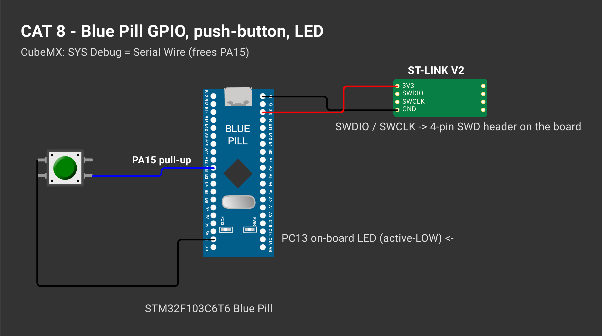

# EXPERIMENT DETAILS

**EXP:** CONTINUOUS ASSESSMENT 8

**DATE:** 18/09/2026

**NAME OF EXP:** STM32 GPIO Bring-Up and Switch-Controlled LED

**HARDWARE SETUP / PLATFORM:** Blue Pill STM32F103C6T6 (ARM Cortex-M3, 72 MHz) + push-button — STM32CubeMX + Keil MDK-ARM (STM32CubeIDE project included), STM32 HAL

---

## TASK 8C : Short Press vs Long Press

### 1. Circuit Diagram

| Pin | CubeMX Mode | Hardware Connection |
|---|---|---|
| `PC13` | `GPIO_Output`, push-pull | On-board user LED (**active-LOW**) |
| `PA15` | `GPIO_Input`, internal pull-up | Tactile push-button switching to `GND` |
| `PA13` / `PA14` | `SYS`: Debug = Serial Wire (SWD) | ST-LINK debugger (releases `PA15` from JTAG `JTDI`) |
| `RCC` | 8 MHz HSE crystal → PLL ×9 | 72 MHz system clock |

*Created in [Wokwi](https://wokwi.com). To view or modify the schematic: open a new project on wokwi.com, copy [`wokwi/diagram.json`](wokwi/diagram.json) into the `diagram.json` editor, and upload any accompanying `wokwi/*.chip.json` custom definitions via **New file**. Custom chip definitions represent the AT89S52, USB-TTL adapter, ULN2003 driver, USBasp programmer, and ST-LINK dongle. In later diagrams, the ESP-01 and BMP180 symbols represent the Wemos D1 mini and BME280 respectively (sharing identical pinouts and protocols), while the Nucleo-64 board represents the F401RE.*

### 2. Core Logic / Pseudocode / Code Base

**Working Principle:**

When a debounced press edge occurs, the firmware records `press_start_ms` and continues running the main loop. When the matching release edge arrives, the hold duration (`release_ms − press_start_ms`) is evaluated: holds under 1 s are classified as short presses, while holds of 1 s or longer are classified as long presses. Because classification happens **at button release**, continuous blinking begins once a long press is released rather than mid-hold.

| User Input | LED Behaviour |
|---|---|
| Short press (< 1 s) | Toggle static LED state |
| Long press (≥ 1 s) | Enter continuous 200 ms blinking mode |
| Short press while blinking | Exit blinking mode |
| Subsequent long press | Re-enter blinking mode |

**Pseudocode:**

1. Latch `press_start_ms` on a debounced press edge.
2. Compute hold duration on the subsequent release edge.
3. If hold duration ≥ 1000 ms (long press), set `blinking = 1`.
4. If hold duration < 1000 ms (short press), clear `blinking` if currently blinking; otherwise invert the LED.
5. While `blinking` is active, invert `PC13` every 200 ms using `HAL_GetTick()`.

**Code Base:**

- Project files: `CAT08C_Short_vs_Long_Press.ioc` (STM32CubeMX configuration), `MDK-ARM/CAT08C_Short_vs_Long_Press.uvprojx` (Keil MDK), `.project` / `.cproject` (STM32CubeIDE); firmware entry point in `Core/Src/main.c`.
- `classify_press()`
- Non-blocking `HAL_GetTick()` timestamps used for both hold measurement and blink pacing (zero `HAL_Delay()` calls)

### 3. Inference

Using non-blocking `HAL_GetTick()` timestamps allows the MCU to measure button hold duration and pace a 200 ms LED blink concurrently without freezing execution.
